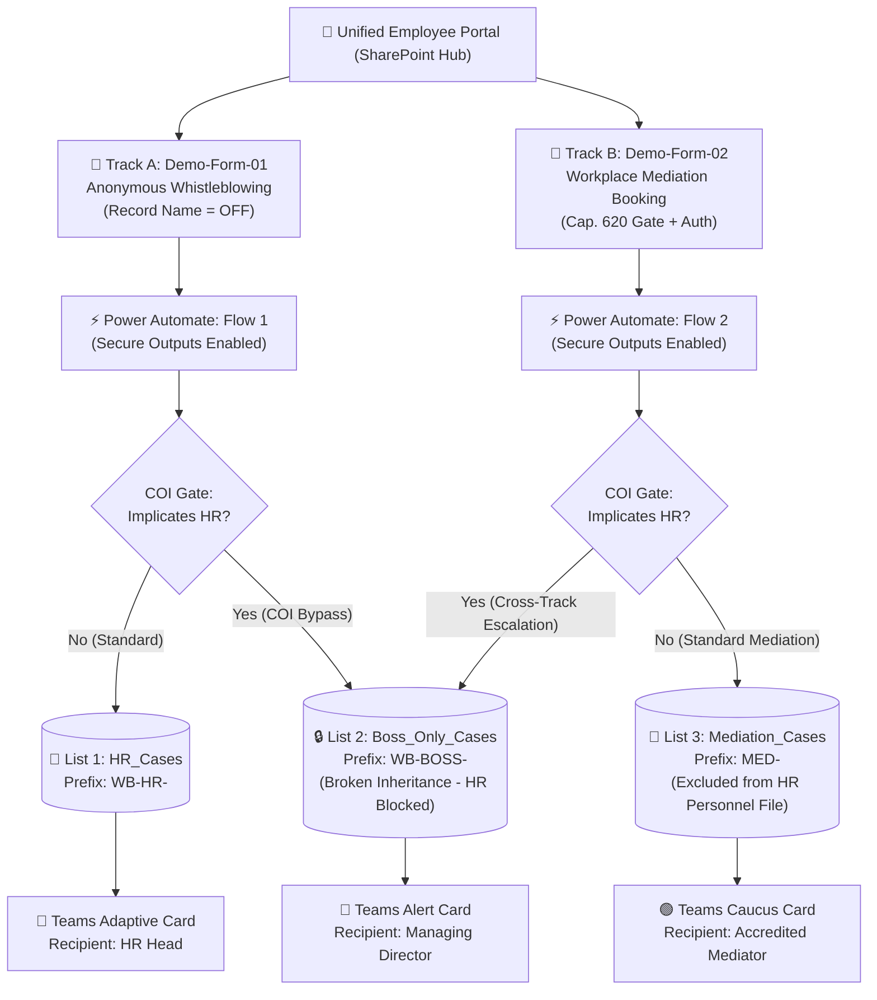
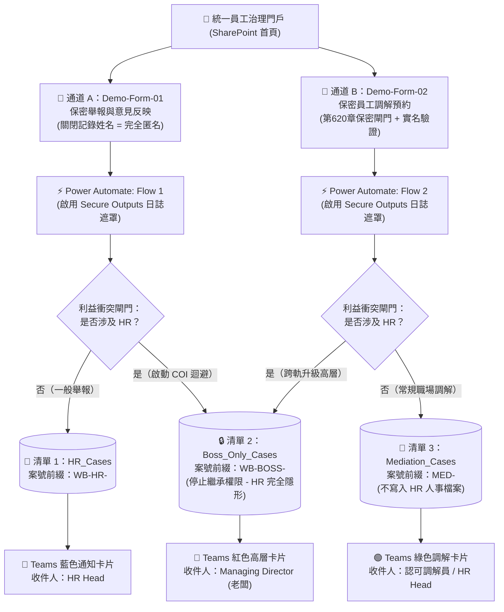

# EnterpriseDemo-SpeakUp-Mediation
**Zero-License Enterprise Whistleblowing & Workplace Mediation Dual-Track Governance Portal**

[](https://jackylawck.github.io/EnterpriseDemo-SpeakUp-Mediation/)
[](./docs/compliance-and-regulatory-scope.md)
[](./docs/compliance-and-regulatory-scope.md)
[](./docs/compliance-and-regulatory-scope.md)
[](./SECURITY.md)
[](./LICENSE)

> 🚀 **Live Interactive Demo & RBAC Simulator:** **[https://jackylawck.github.io/EnterpriseDemo-SpeakUp-Mediation/](https://jackylawck.github.io/EnterpriseDemo-SpeakUp-Mediation/)**  
> *Test the Conflict-of-Interest (COI) bypass logic and toggle between HR Head vs. Managing Director views directly in your browser—no M365 login required.*

---

## 1. Executive Summary & Architectural Value

`EnterpriseDemo-SpeakUp-Mediation` is an open-source **Governance-as-Code** reference architecture demonstrating how enterprises can deploy a compliant, dual-track internal ethics and conflict-resolution platform using **100% native Microsoft 365 Standard Licenses** (Forms, Power Automate, SharePoint Online, and Teams)—eliminating recurring third-party SaaS licensing costs while preserving full **Data Sovereignty**.

Conventional corporate reporting systems suffer from two structural governance blind spots:
1. **Single-Point HR Administration Failure:** When a grievance or misconduct report implicates HR leadership itself, routing through standard HR channels creates an immediate Conflict of Interest (COI) and chills employee reporting.
2. **Absence of Early Non-Adversarial Resolution:** Without a confidential workplace mediation channel, everyday interpersonal or cross-departmental friction escalates unnecessarily into formal disciplinary complaints.

This platform resolves both issues via a **"Two Front Doors, Unified High-Risk Escalation"** architecture.

---

## 2. Dual-Track Routing & COI Isolation Architecture



---

## 3. Core Governance & Security Controls

* **Automated Conflict-of-Interest (COI) Bypass (ISO 37002):** Any whistleblowing report or mediation request implicating HR leadership automatically bypasses HR queues, writes exclusively to `Boss_Only_Cases`, and alerts the Managing Director (`md@companydemo.com`) via a high-priority Teams Adaptive Card.
* **Broken-Inheritance List Isolation (ISO/IEC 27001):** Backend SharePoint lists break permission inheritance from the parent site. HR personnel (`hr.head@companydemo.com`) have zero read, write, or search visibility into `Boss_Only_Cases`.
* **Log Redaction via Secure Outputs (HK PDPO DPP4):** Power Automate `Get response details` actions enforce `Secure Outputs`, preventing plaintext sensitive disclosures from appearing in workflow execution logs.
* **Statutory Mediation Confidentiality (HK Mediation Ordinance Cap. 620):** Mediation intake requires mandatory upfront acknowledgment of voluntary, neutral, and "without prejudice" principles, with institutional separation from HR personnel files.
* **Deterministic Non-AI Regulatory Scope-Out:** Built strictly on deterministic `If/Else` conditional rules and human-in-the-loop review—intentionally avoiding High-Risk AI regulatory overhead under the EU AI Act, ISO/IEC 42001, and CAC generative AI rules.
* **Zero-Inline Strict CSP Portal:** The web showcase enforces `default-src 'none'; script-src 'self'; style-src 'self'` (zero `'unsafe-inline'`) and `textContent` DOM rendering to eliminate XSS vectors.

---

## 4. Repository Structure & Engineering Artifacts

```text
EnterpriseDemo-SpeakUp-Mediation/
├── index.html                                      # Bilingual Interactive Portal (Strict CSP + SEO)
├── assets/
│   ├── css/style.css                               # Modular dark enterprise governance stylesheet
│   └── js/app.js                                   # Bilingual switcher & interactive RBAC simulator
├── docs/
│   ├── compliance-and-regulatory-scope.md          # Global regulatory & Non-AI scope-out assessment
│   ├── forms-design-and-branching.md               # Demo-Form-01 & Demo-Form-02 schemas & gates
│   ├── sharepoint-permissions-matrix.md            # Broken-inheritance RBAC matrix & list specs
│   └── adaptive-cards-templates.md                 # Red / Blue / Green Teams Adaptive Card JSONs
├── flows/
│   ├── Flow1_Whistleblowing_Routing.json           # Sanitized Power Automate workflow (Whistleblowing)
│   └── Flow2_WorkplaceMediation_Intake.json        # Sanitized Power Automate workflow (Mediation)
├── schemas/
│   └── speakup_mediation_governance_schema.json    # JSON Schema for RBAC & compliance metadata
├── README.md                                       # English documentation (Default)
├── README.zh-TW.md                                 # Traditional Chinese (Hong Kong) documentation
├── SECURITY.md                                     # Security policy & legal disclaimer
└── LICENSE                                         # MIT License

```

---

## 5. Deployment Quick-Start (M365 Tenant)

1. **Provision SharePoint Lists:** Create `HR_Cases`, `Boss_Only_Cases`, and `Mediation_Cases` inside a private SharePoint communication/team site, breaking inheritance on `Boss_Only_Cases` per [`docs/sharepoint-permissions-matrix.md`](https://www.google.com/search?q=./docs/sharepoint-permissions-matrix.md).
2. **Create Microsoft Forms:** Build `Demo-Form-01` (Anonymous) and `Demo-Form-02` (Authenticated) following [`docs/forms-design-and-branching.md`](https://www.google.com/search?q=./docs/forms-design-and-branching.md).
3. **Import & Bind Cloud Flows:** Configure the two workflows using [`flows/Flow1_Whistleblowing_Routing.json`](https://www.google.com/search?q=./flows/Flow1_Whistleblowing_Routing.json) and [`flows/Flow2_WorkplaceMediation_Intake.json`](https://www.google.com/search?q=./flows/Flow2_WorkplaceMediation_Intake.json), replacing placeholder GUIDs and emails with your tenant endpoints.
4. **Publish Unified Hub:** Embed both form links as side-by-side action buttons on your internal SharePoint landing page.

---

## 6. Author & Legal Disclaimer

* **System Architect:** 羅子淇 (Jacky Law) — Corporate Governance & Low-Code Automation Architect
* **Disclaimer:** This repository is a sanitized **Enterprise Demo** created for architectural and governance research. All Tenant IDs, Form GUIDs, SharePoint URLs, and email addresses are synthetic placeholders. Compliance mappings are provided for informational reference only and do not constitute formal legal advice. Released under the [MIT License](https://www.google.com/search?q=./LICENSE).

```

---

### 2. `README.zh-TW.md`（全繁體中文香港版）
*(路徑：在 GitHub 點擊 `Add file` $\rightarrow$ `Create new file` $\rightarrow$ 輸入 `README.zh-TW.md`)*

```markdown
🌐 語言切換: [English](./README.md) | **繁體中文 (香港)**

# EnterpriseDemo-SpeakUp-Mediation
**企業保密舉報與員工調解雙軌治理平台（零額外授權 M365 原生架構示範）**

[](https://jackylawck.github.io/EnterpriseDemo-SpeakUp-Mediation/)
[](./docs/compliance-and-regulatory-scope.md)
[](./docs/compliance-and-regulatory-scope.md)
[](./docs/compliance-and-regulatory-scope.md)
[](./SECURITY.md)
[](./LICENSE)

> 🚀 **線上互動展示與權限隔離模擬器：** **[https://jackylawck.github.io/EnterpriseDemo-SpeakUp-Mediation/](https://jackylawck.github.io/EnterpriseDemo-SpeakUp-Mediation/)**  
> *無需登入 M365 帳號，直接在瀏覽器測試「利益衝突自動繞過 HR」路由邏輯，並一鍵切換「HR Head」與「Managing Director（老闆）」後台視角！*

---

## 1. 專案摘要與治理價值

`EnterpriseDemo-SpeakUp-Mediation` 是一套開源的**「治理即代碼」（Governance-as-Code）**企業內控參考架構，展示如何 **100% 運用企業現有 Microsoft 365 標準授權**（Forms、Power Automate、SharePoint Online 及 Teams），在**零額外第三方 SaaS 採購成本**及**數據完全留存自家租戶（Data Sovereignty）**的前提下，搭建兼具「保密舉報（Whistleblowing）」與「員工職場調解（Workplace Mediation）」的雙軌治理平台。

傳統企業內部申訴機制往往存在兩大結構性治理盲點：
1. **HR 單點管理導致利益衝突：** 當舉報或投訴對象涉及人力資源部主管本身時，若仍由 HR 系統統一收件，將造成嚴重利益衝突（COI）並令員工卻步。
2. **缺乏非對抗性早期疏導管道：** 若缺乏獨立保密的職場調解通道，日常跨部門溝通落差或工作分配摩擦往往被迫升級為正式投訴或紀律處分。

本系統透過**「前端雙軌分流、後端高層機密匯流」**架構徹底解決上述痛點。

---

## 2. 雙軌分流與利益衝突（COI）隔離架構圖



---

## 3. 核心管治與資安防禦機制

* **利益衝突（COI）自動繞過 HR（對齊 ISO 37002）：** 任何舉報或調解申請一旦勾選涉及人力資源主管，系統立即繞過 HR 隊列，寫入獨立隔離之 `Boss_Only_Cases` 清單，並透過 Teams 紅色高層卡片通知 Managing Director（`md@companydemo.com`）。
* **清單級停止繼承權限隔離（對齊 ISO/IEC 27001）：** 後端三張 SharePoint 清單均中斷繼承父網站權限，HR 人員（`hr.head@companydemo.com`）對 `Boss_Only_Cases` 完全無讀取、編輯及搜尋可見度。
* **安全輸出防執行日誌洩漏（對齊香港 PDPO DPP4）：** 在 Power Automate `取得回應詳細資料` 積木啟用 `Secure Outputs`，確保舉報明文不會留存於流程執行歷史日誌中。
* **法定調解保密與不入人事檔案（對齊香港《調解條例》第 620 章）：** 預約表單強制確認「自願、中立、無損權利（Without Prejudice）」原則，並以制度隔離調解紀錄與 HR 個人人事檔案。
* **確定性非 AI 監管豁免邊界（Non-AI Scope-Out）：** 系統完全基於確定性 `If/Else` 條件規則與專人實質審核，依法豁免歐盟 AI 法案（EU AI Act）、ISO/IEC 42001 及國家網信辦生成式 AI 規範，避免過度合規。
* **零內聯嚴格資安策略（Strict CSP）：** 展示網頁實施 `default-src 'none'; script-src 'self'; style-src 'self'`（徹底移除 `'unsafe-inline'`）及純 `textContent` DOM 渲染，杜絕 XSS 風險。

---

## 4. 儲存庫目錄結構與工程交付物

```text
EnterpriseDemo-SpeakUp-Mediation/
├── index.html                                      # 雙語互動展示門戶（Strict CSP + 完整 SEO）
├── assets/
│   ├── css/style.css                               # 模組化深色企業管治樣式表
│   └── js/app.js                                   # 雙語無閃爍切換與互動式權限隔離模擬器
├── docs/
│   ├── compliance-and-regulatory-scope.md          # 全球法規、ISO 對齊與「非 AI 豁免邊界」評估報告
│   ├── forms-design-and-branching.md               # 雙問卷結構設計與利益衝突閘門邏輯
│   ├── sharepoint-permissions-matrix.md            # 三清單停止繼承權限隔離矩陣
│   └── adaptive-cards-templates.md                 # 紅 / 藍 / 綠三色 Teams 調適型卡片範本
├── flows/
│   ├── Flow1_Whistleblowing_Routing.json           # 脫敏版 Power Automate 流程一（保密舉報分流）
│   └── Flow2_WorkplaceMediation_Intake.json        # 脫敏版 Power Automate 流程二（員工調解預約）
├── schemas/
│   └── speakup_mediation_governance_schema.json    # 治理數據結構與 RBAC 權限隔離 JSON Schema
├── README.md                                       # 全英文版說明文件（預設入口）
├── README.zh-TW.md                                 # 全繁體中文（香港）版說明文件
├── SECURITY.md                                     # 資安政策與法律免責聲明
└── LICENSE                                         # MIT License

```

---

## 5. 快速部署指南（M365 企業租戶）

1. **建立 SharePoint 隔離清單：** 於私密 SharePoint 網站建立 `HR_Cases`、`Boss_Only_Cases` 及 `Mediation_Cases`，並依 [`docs/sharepoint-permissions-matrix.md`](https://www.google.com/search?q=./docs/sharepoint-permissions-matrix.md) 設定 `Boss_Only_Cases` 停止繼承權限。
2. **建立雙軌 Microsoft Forms：** 參照 [`docs/forms-design-and-branching.md`](https://www.google.com/search?q=./docs/forms-design-and-branching.md) 建立匿名舉報表單（`Demo-Form-01`）與實名調解預約表單（`Demo-Form-02`）。
3. **配置 Power Automate 雲端流程：** 參照 [`flows/Flow1_Whistleblowing_Routing.json`](https://www.google.com/search?q=./flows/Flow1_Whistleblowing_Routing.json) 與 [`flows/Flow2_WorkplaceMediation_Intake.json`](https://www.google.com/search?q=./flows/Flow2_WorkplaceMediation_Intake.json) 建立兩條分流流程，將佔位符 GUID 與電郵替換為貴司租戶資訊。
4. **發布統一員工門戶：** 於內部 SharePoint 首頁並列放置兩張表單連結按鈕，完成「雙軌合一」員工入口。

---

## 6. 法律免責聲明

* **免責聲明：** 本儲存庫為企業管治架構研究而設之通用示範專案（**Enterprise Demo**），文中所有 Tenant ID、表單 GUID、SharePoint 網址及電郵地址均為脫敏佔位符。合規對照分析僅供架構參考，不構成正式法律意見。本專案依 [MIT License](https://github.com/jackylawck/EnterpriseDemo-SpeakUp-Mediation/blob/main/LICENSE) 授權發佈。

